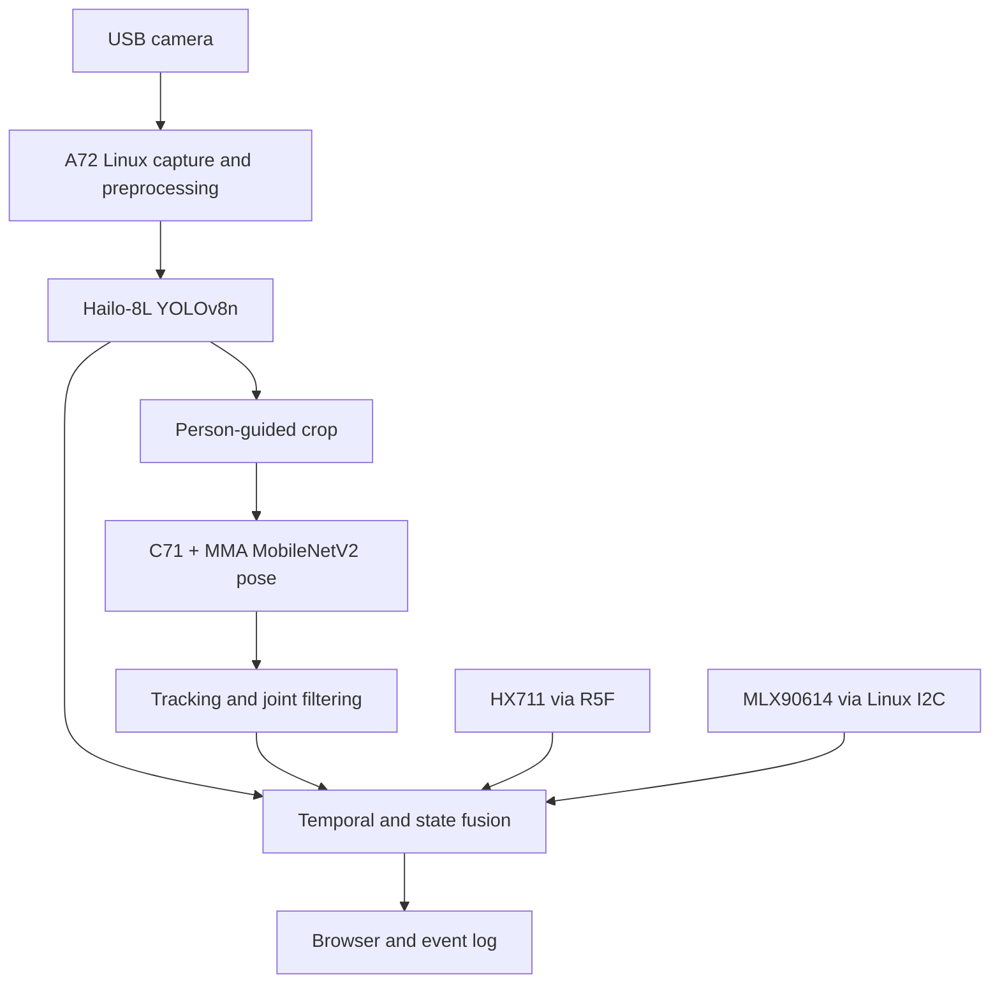

# BeagleBone AI-64 × Hailo-8L

## Heterogeneous Multicore Embedded AI System with Dual-NPU, Dual-Model Cooperative Inference and Sensor Fusion

[繁體中文](README.md) · [Architecture](docs/architecture.md) · [Model pipelines](docs/model-pipelines.md) · [Operations and reproduction](docs/operations.md) · [Validation](docs/validation.md) · [Development notes](docs/development-notes.md)

An automatically started desktop interaction sensing system combining **Hailo-8L object detection, TI C71/MMA human pose estimation, R5F real-time load sensing and Linux infrared temperature acquisition**.

YOLO detects people and objects. Its person bounding box drives the pose-model crop. Linux associates load transitions with object classes, recent wrist proximity and surface temperature to produce placement/removal events. The project covers model conversion from original checkpoints, quantization, custom remote-core firmware, memory reservation, interprocessor communication, concurrent processing and deployment.

**Author: Fan Chia-Hao (范家豪).**

“Dual-NPU” is project shorthand for the **Hailo-8L and TI MMA acceleration units**. C71 is the DSP running TIDL and controlling MMA execution; R5F handles sensing. Neither C71 alone nor R5F is counted as an additional NPU.

### Implemented system

- Two systemd services start at boot without an interactive SSH session.
- The browser shows detection boxes, pose skeleton, load presence, infrared surface temperature and recent interaction events.
- Both deployed models are generated through the project's conversion pipelines, starting with pretrained checkpoints.
- Person-guided affine cropping and inverse keypoint projection connect the two models. Pose overlays use their corresponding image frame.
- Person tracking, One Euro filtering, confidence hysteresis and short joint holds reduce display flicker. Held points cannot generate new wrist evidence.
- Load sensing determines physical presence; vision names the object when evidence is sufficient. Occlusion does not suppress an otherwise valid load event.

### Engineering work and source map

| Area | Implementation | Source |
|---|---|---|
| Heterogeneous compute | A72/Linux coordination, Hailo detection, C71/MMA pose, R5F sensing | [Architecture](docs/architecture.md) |
| Hailo model deployment | PyTorch → ONNX → HAR → quantization-aware fine-tuning → HEF | [Hailo pipeline](model-pipelines/hailo/) |
| TI model deployment | MMPose → ONNX → floating-point emulation → INT8 calibration → target graph compilation | [TI pipeline](model-pipelines/pose/) |
| Custom C71 runtime | TIDL/MMALIB linking, model assets, memory allocation, cache and padded tensor handling | [C71 service](firmware/c71/pdk-overrides/ti/drv/ipc/examples/common/src/bb_pose_service.c) |
| BSP integration | DDR/MSMC reservation, linker sections, vector slot, remoteproc resource table | [Memory design](docs/architecture.md#記憶體與遠端核心--memory-and-remote-processors) |
| Cross-core transport | RPMsg chunks, frame IDs, offsets, CRC32 and keypoint responses | [Firmware transport](firmware/c71/pdk-overrides/ti/drv/ipc/examples/common/src/bb_pose_transport_v2.inc), [Linux client](runtime/c71_pose_client.py) |
| Real-time sensing | HX711 clock timing protection, signed 24-bit samples, sequence/timestamp checks | [R5F implementation](firmware/r5f/pdk-overrides/ti/drv/ipc/examples/common/src/bb_hx711_v1.h) |
| Concurrency | Separate sensing service, Hailo C++ subprocess, pose worker, latest-frame queue, browser server | [Pose application](runtime/interaction_pose_app.py), [native worker](native/hailo_worker.cpp) |
| Temporal fusion | Tracking, smoothing, joint validity, wrist windows and delayed object confirmation | [Stability](runtime/interaction_pose_stable.py), [actions](runtime/interaction_actions.py), [state machine](runtime/interaction_fusion.py) |
| Operations | Readiness checks, boot tare, signal-driven re-tare, bounded logs and health reporting | [Service support](runtime/service_support.py), [installer](bringup/board/install_interaction_boot.py) |

### Cooperative data flow



The models have a real dependency: the detector defines the pose input region, and pose output contributes to the interaction record. Image, sensor and pose data retain validity and timing information throughout the pipeline.

### Observed measurements

| Test | Observed result | Scope |
|---|---|---|
| Integrated demonstration | Approximately **9.7–10.1 frames/s** | Camera, both models, overlays and browser updates |
| Standalone Hailo streaming | **139.45 frames/s**, 702 frames in about 5 s | `hailortcli run`; not application throughput |
| External C71 upload | Approximately **38 ms** | 147,456-byte RGB/CHW input |
| C71 inference-request round trip | Approximately **7.6–7.7 ms** | Includes communication/service overhead, not pure MMA execution |
| C71 vs TI host emulation | Maximum absolute difference **5.96 × 10⁻⁸** | 52,224 dequantized outputs for one reference image; all 17 peak locations matched |
| Reboot validation | Services active, R5F/C71 running, valid sensors and advancing frames | [Collected boot record](evidence/board/boot-validation.json) |

These results belong to the recorded device and model versions. Numerical agreement with an emulator is not ground-truth pose accuracy. See [validation](docs/validation.md) for evidence types and limitations.

### Two model pipelines

| | Hailo-8L detection | TI C71/MMA pose |
|---|---|---|
| Checkpoint | Pretrained YOLOv8n `.pt` | MMPose MobileNetV2 COCO `.pth` |
| Export | FP32 ONNX, opset 11 | FP32 ONNX, opset 11 |
| Input | 640 × 640 RGB | 192 × 256 RGB person crop |
| Calibration / validation | 1,024 / 128 captured images | 64 / 32 crops from separate source splits |
| Conversion tool | Hailo DFC 3.33.1 | TIDL 08.00.00.10 |
| Optimization | INT8 calibration, four fine-tuning epochs | INT8 parameter/feature calibration |
| Deployment | `yolov8n_custom_hailo8l.hef` | TIDL network/IO `.bin` linked into `.xe71` service firmware |
| Runtime | HailoRT 4.23.0 C++ | TIDL/MMALIB and Linux RPMsg client |

Pretrained classes are retained. Hailo fine-tuning compensates for quantization; it does not add custom object classes. Detection postprocessing is described by the HEF and uses the selected HailoRT CPU postprocessing path, so it is not all NPU computation.

### Running the already provisioned board

Boot with an empty platform, visit `http://<board-ip>:8080`, fix the camera and select the platform ROI. Operate one object at a time.

```bash
sudo python3 -u "$HOME/interaction_demo/service-current/service_support.py" status
sudo systemctl reload bbai64-interaction-sensors.service
sudo journalctl -b \
  -u bbai64-interaction-sensors.service \
  -u bbai64-interaction-vision.service \
  -n 80 --no-pager
```

The reload command performs tare and requires an empty platform. Use `sudo reboot` for a board restart. R5F warm stop/start failures were observed, so the sensing service deliberately has no unrestricted restart loop.

### Repository and reproduction scope

- [`runtime/`](runtime/): exact Python sources collected from the boot-validated service version.
- [`native/`](native/): HailoRT C++ worker.
- [`firmware/`](firmware/): custom firmware, relevant PDK overrides and linker configuration.
- [`model-pipelines/`](model-pipelines/): export/calibration/build scripts, configuration and environment manifests.
- [`bringup/`](bringup/): boot installer and its manual-program inputs.
- [`deploy/`](deploy/): service units from the validated deployment.
- [`evidence/`](evidence/): original phase reports and boot validation.
- [`provenance/`](provenance/): source mapping, SHA256 values and exclusion reasons.
- [`tests/`](tests/): hardware-independent state/timing regression tests.

This release is an auditable implementation and deployment baseline. Historical build scripts retain their original workspace layout, artifact hashes and phase gates; they are not yet a relocatable clean-machine installer. TI/Hailo SDKs, compilers, binary models, calibration images and personal recordings are not bundled. [Operations and reproduction](docs/operations.md) describes prerequisites, artifact contracts and remaining packaging gaps.

### Interpretation limits

Presence is not calibrated mass. Infrared measurements describe the sensor's surface field of view and are not registered automatically to a detected object. Wrist proximity is visual evidence rather than proof of contact or causation. One person and one platform object are handled at a time; occlusion or low confidence can remove visible joints. The unauthenticated web interface is intended for a trusted local demonstration network.

[Third-party notices](THIRD_PARTY_NOTICES.md) · [Demonstration recording plan](docs/demo-recording.md)
