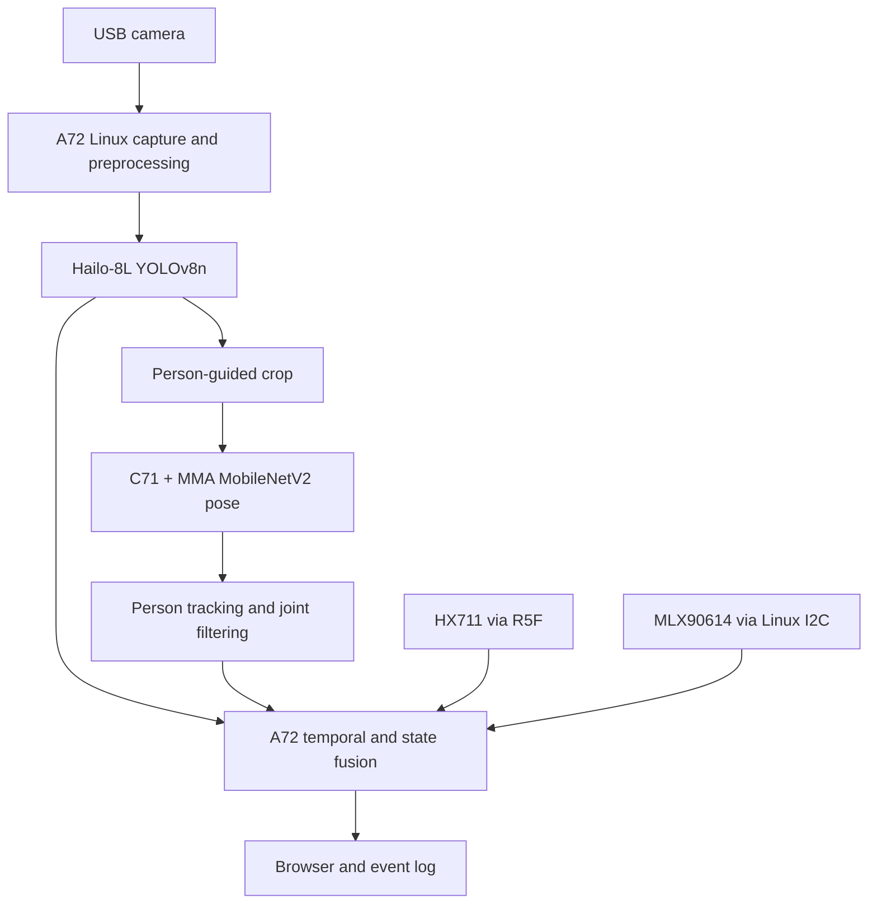

# BeagleBone AI-64 × Hailo-8L

[繁體中文](README.md) | **English**

## Heterogeneous Multicore Embedded AI System with Dual-NPU, Dual-Model Cooperative Inference and Sensor Fusion

[Architecture](docs/architecture.md) · [Model pipelines](docs/model-pipelines.md) · [Operations and reproduction](docs/operations.md) · [Validation](docs/validation.md) · [Development notes](docs/development-notes.md)

An embedded AI system built around BeagleBone AI-64, with **A72 Linux, Hailo-8L, TI C71/MMA and R5F** assigned distinct responsibilities. Its desktop interaction sensing application combines camera-based person and object detection, human pose estimation, load-based placement/removal detection and infrared surface temperature display.

**The engineering work connects board support, model deployment, remote-core firmware and the Linux application.** It spans export, calibration, quantization and compilation of two pretrained models; a C71 inference service and R5F sensing firmware; device-tree memory reservations, linker placement, cache management and interprocessor communication; and deployment as services that start automatically at boot.

The models form a dependent pipeline: Hailo's person bounding box determines the crop supplied to the TI pose model, and the resulting wrist observations are associated with load transitions, object classes and timing information. The application addresses asynchronous inference, coordinate projection, stale data, occlusion and sensor events that arrive before visual classification is ready.

**Author: Fan Chia-Hao (范家豪).**

> “Dual-NPU” refers to the **Hailo-8L and TI MMA acceleration units**. C71 is the DSP running the TIDL pose service and using MMA; R5F handles sensing. Neither C71 alone nor R5F is counted as an additional NPU.

### Implemented system

- Two systemd services start at boot without an interactive SSH session.
- The browser shows detection boxes for people, bottles, cups and phones, alongside the pose skeleton, load presence, infrared surface temperature and recent interaction events.
- Both deployed models are generated through the project's export, calibration, quantization and compilation pipelines, starting with pretrained checkpoints.
- Person-guided affine cropping and inverse keypoint projection connect the models. Pose overlays use their corresponding image frame.
- Person tracking, adaptive smoothing, confidence hysteresis and short joint holds reduce display flicker. Held points cannot generate new wrist evidence.
- Load sensing determines physical presence; vision names the object when evidence is sufficient. Occlusion does not suppress an otherwise valid load event with an unconfirmed class.

### Compute and hardware responsibilities

| Unit / hardware | Responsibility | System interface |
|---|---|---|
| Dual-core A72 / Linux | Camera capture, preprocessing, model coordination, coordinate projection, event fusion and browser interface | OpenCV, processes/threads and system services |
| Hailo-8L | Execute the YOLOv8n detection network to produce person and object candidates | PCIe and a native HailoRT C++ worker process |
| C71 DSP / MMA | C71 runs the pose service, TIDL runtime and output decoding; MMA accelerates model computation | Linux remoteproc and RPMsg |
| MAIN R5F / HX711 | Generate the read clock, acquire 24-bit raw load samples and report sequence/timing information | Firmware-controlled GPIO and RPMsg replies |
| MLX90614 | Measure surface temperature within the infrared field of view | Linux I2C acquisition |
| C270 USB camera | Supply the shared image source for detection and pose estimation | Linux camera interface and a stable device identifier |

The Linux scheduler manages application work on A72; R5F and C71 execute their separately loaded firmware. Application protocols coordinate the processors, and A72 performs data fusion. This deployment uses MAIN R5F and C71. The C66 cores are unused and must remain offline under the C71 startup checks to avoid conflicts in this custom resource configuration.

### Cooperative data flow



### Board support and C71 inference firmware

**Running the model on C71/MMA requires coordinated memory configuration on both Linux and the remote firmware.** The project integrates TI's Platform Development Kit (PDK), SYS/BIOS, the TI Deep Learning (TIDL) runtime and Matrix Multiplication Accelerator Library (MMALIB) into a pose service that Linux can start and call.

- **Memory ownership:** Reserve an additional 128 MiB of DDR through the device tree, verify that it is excluded from ordinary Linux RAM and check that C71's `memory-region` references it. Reserve on-chip MSMC SRAM separately for inference.
- **Firmware placement:** Coordinate linker sections, a dedicated 16 KiB vector-table slot, model assets and a 96 MiB TIDL heap, keeping resource-table, cache and MMU configuration consistent.
- **Inference runtime:** Allocate the memory regions requested by TIDL, connect initialization, model execution and output extraction, and configure the DMA, event routing and cache behavior required by the SDK.
- **Tensor layout:** Validate the deployed pose model's IO descriptors for dimensions, types, padding and pitches. Copy between tightly packed application images and TIDL buffers, then decode keypoints from the output heatmaps.
- **Startup checks:** Resolve C71 by its hardware name, `64800000.dsp`, and verify firmware hashes, model identity, protocol version and processor state instead of relying on a changing `remoteprocN` index.

Source: [C71 inference service](firmware/c71/pdk-overrides/ti/drv/ipc/examples/common/src/bb_pose_service.c), [linker configuration](firmware/c71/pdk-overrides/ti/drv/ipc/examples/common/j721e/linker_c7x_c7x_1_sysbios.lds) and [Linux startup/memory checks](runtime/c71_pose_client.py). See [architecture](docs/architecture.md#記憶體與遠端核心--memory-and-remote-processors) for the memory map and configuration relationships.

### Cross-core image transport and result delivery

Linux and C71 communicate through the custom `C71_TIDL_POSE_V2` protocol. Each pose input is a 192 × 256 RGB image in channel-first (CHW), unsigned 8-bit format, totaling 147,456 bytes. The client divides the image into chunks containing up to 240 bytes of image data, each sent with a protocol header through RPMsg.

1. **Begin a frame transaction:** Send the frame identifier, total length and whole-image CRC32.
2. **Upload chunks:** Include the frame identifier and offset in every chunk. The receiver checks the expected position, and the client verifies the next offset in the acknowledgment.
3. **Validate before inference:** Run the model request only after the receiver has accepted the complete image and verified its CRC32.
4. **Return matching results:** The live path retrieves positions and scores for 17 keypoints; a diagnostic path can read the complete heatmaps. The client checks frame identity and response format again.

This supports a continuing stream of external camera inputs while distinguishing transport failures, frame mismatches and model-output issues. Timeouts are reported without blindly resending requests that may already have executed.

Source: [C71 transport handler](firmware/c71/pdk-overrides/ti/drv/ipc/examples/common/src/bb_pose_transport_v2.inc) and [Linux client](runtime/c71_pose_client.py).

### Asynchronous processing and coordinate consistency

The models use different input sizes, and capture and inference progress at different rates. The application manages **work scheduling, frame identity and coordinate transforms together**:

- Resize camera images while preserving aspect ratio, then letterbox them to Hailo's 640 × 640 RGB input. Retain scale and padding parameters.
- Adjust the person box to the pose model's aspect ratio and apply an affine transform to produce a 192 × 256 crop. Project returned keypoints back to the source image through the inverse transform.
- Run Hailo in a native C++ subprocess, coordinated from Python through image input and JSON output. A dedicated pose worker thread calls C71.
- Keep **only the latest pending pose job** and discard stale work, preventing slower inference from accumulating an unbounded backlog of old frames.
- Retain the image, person box and transform parameters with each in-flight job. Draw its returned skeleton on that image rather than applying old keypoints to a newer frame.
- Check monotonic timestamps, sensor-process identity and region-of-interest (ROI) revisions. A service restart or ROI change cannot silently turn old observations into new event evidence.

Source: [image and pose scheduling](runtime/interaction_pose_app.py), [Hailo C++ worker](native/hailo_worker.cpp) and [temporal fusion](runtime/interaction_fusion.py).

### Real-time sensing, pose stability and interaction events

**R5F controls HX711 read timing; Linux interprets the samples and manages events.** Firmware temporarily disables interrupts during the clock-high critical section to prevent interrupt servicing from extending the pulse. It also checks pulse duration and bounds its wait for data readiness. Replies include raw samples, sequence numbers and remote timing information. Linux checks freshness and state before converting raw counts into object presence.

Event interpretation combines three sources with distinct meanings:

| Information | Role in the system | Processing |
|---|---|---|
| Load transitions | Determine empty-to-occupied and occupied-to-empty changes | Median filtering, separate entry/exit thresholds and consecutive confirmation |
| Object detections | Associate an object class with placement/removal events | Platform ROI, one candidate, temporal class stability and delayed confirmation |
| Human keypoints | Add evidence that a wrist was near the platform around an event | Bounding-box IoU tracking, One Euro filtering, joint-confidence state and a bounded event window |

When the load changes before the object becomes visible, the state machine allows a short classification window. If evidence remains insufficient, it preserves the event with an unconfirmed class. The pose display can briefly hold joints to reduce flicker, but **held joints cannot generate new wrist-proximity evidence**. Display smoothing and event interpretation therefore use different validity rules.

Source: [R5F HX711 firmware](firmware/r5f/pdk-overrides/ti/drv/ipc/examples/common/src/bb_hx711_v1.h), [sensor service](runtime/interaction_sensors.py), [pose stability](runtime/interaction_pose_stable.py), [fusion state machine](runtime/interaction_fusion.py) and [interaction events](runtime/interaction_actions.py).

### Two model pipelines

Each model uses its own toolchain to produce deployment artifacts. Project scripts prepare data, connect build stages, configure tools and verify artifacts; model optimization and device compilation use Hailo and TI tools.

| | Hailo-8L detection | TI C71/MMA pose |
|---|---|---|
| Checkpoint | Pretrained YOLOv8n `yolov8n.pt` | MMPose MobileNetV2 COCO `.pth` |
| Export | FP32 ONNX, opset 11 | FP32 ONNX, opset 11 |
| Input | 640 × 640 RGB | 192 × 256 RGB person crop |
| Calibration / validation | 1,024 / 128 captured images | 64 / 32 person crops from separate source splits |
| Conversion tool | Hailo DFC 3.33.1 | TIDL 08.00.00.10 |
| Optimization | INT8 calibration and four quantization-aware fine-tuning epochs | INT8 parameters/features and ten bias-calibration iterations |
| Deployment | `yolov8n_custom_hailo8l.hef` | TIDL network/IO `.bin` linked into `.xe71` service firmware |
| Runtime | HailoRT 4.23.0 C++ | TIDL/MMALIB and Linux RPMsg client |

#### Hailo-8L object detection conversion flow

| Stage | File | API or tool | Operation |
|---|---|---|---|
| Checkpoint | `yolov8n.pt` | Ultralytics `YOLO`, PyTorch | Load the pretrained model |
| Export | `yolov8n.onnx` | `YOLO.export`, ONNX, ONNX Runtime | Export an FP32, opset 11 model with static input and compare numerically with PyTorch |
| Parse | `yolov8n_hailo8l.parsed.har` | `hailo_sdk_client.ClientRunner.translate_onnx_model`, `save_har` | Extract six detection branches and convert them into Hailo's network representation |
| Native optimization | `yolov8n_hailo8l.fp.har` | `load_model_script`, `optimize_full_precision` | Configure normalization, score branches and non-maximum suppression (NMS) |
| Quantization and fine-tuning | `yolov8n_hailo8l.quantized.har` | `ClientRunner.optimize` | Calibrate quantization ranges, perform quantization-aware fine-tuning and analyze noise |
| Hardware compilation | `yolov8n_custom_hailo8l.hef` | `ClientRunner.compile` | Allocate Hailo-8L resources and compile three execution contexts |
| Board inference | HEF | HailoRT C++ `Hef`, `VDevice`, `InferVStreams` | Load the model, stream inputs, run inference and perform detection postprocessing |

**Hailo pipeline:** Export ONNX, identify YOLO's six detection heads and create the Hailo Archive (HAR). Configure normalization, score transforms and non-maximum suppression (NMS) in the model script, then calibrate, fine-tune for quantization and compile the HEF. The board supplies UINT8 images, with preprocessing kept consistent with model-side normalization.

#### TI C71/MMA human pose conversion flow

| Stage | Artifact | Tool |
|---|---|---|
| Original model | `mobilenetv2_coco_256x192-d1e58e7b_20200727.pth` | MMPose 0.29.0, MMCV, PyTorch |
| Export | `mobilenetv2_pose_256x192.fp32.onnx` | PyTorch ONNX export and ONNX Runtime comparison |
| FP32 validation | TI floating-point network and outputs | `tidl_model_import.out`, `PC_dsp_test_dl_algo.out` |
| Calibration | 64 calibration person crops and 32 validation person crops | YOLO person boxes and MMPose-compatible affine crops |
| INT8 import | TIDL network `.bin` and input/output descriptor `.bin` | `tidl_model_import.out`, calibration and graph compilation |
| Target mapping | Dataflow configuration within the network | `ti_cnnperfsim.out` |
| Firmware linking | `c71-pose-v2.xe71` | TI C7000 compiler, PDK IPC, SYS/BIOS, TIDL, MMALIB |
| Runtime | 17 keypoints | C71 service, MMA, RPMsg client |

**TI pipeline:** Check the ONNX model and TI floating-point host emulation, then use person crops for INT8 calibration and target graph compilation. Convert network and IO descriptions into firmware assets, use the C7x toolchain to link TIDL, MMALIB and the pose service into firmware, and decode heatmaps according to the output descriptors.

Pretrained classes are retained. Quantization fine-tuning reduces conversion error; it does not add custom object classes. Hailo's detection postprocessing is described by the HEF and uses the selected HailoRT CPU postprocessing path. See [model pipelines](docs/model-pipelines.md) for the complete workflows.

### From prototype to persistent services

| Integration issue | Project implementation |
|---|---|
| Linux indices for processors and peripherals can change | Resolve processors, I2C and the camera through hardware names, device-tree controllers and stable device paths |
| C71 inference needs additional memory and padded tensor layouts | Align device-tree reservations, linker placement, resource tables, cache configuration and TIDL IO descriptors; check the live configuration before startup |
| An embedded test image is insufficient for a live application | Add chunked external-image upload and integrity checks; retain original/mirrored/restored-image validation |
| Asynchronous pose results can mismatch frames or accumulate delay | Keep the latest pending job, reject stale work, draw on the matching frame and apply inverse coordinate projection |
| Person switching, joint flicker and occlusion disrupt the display | Maintain person continuity, adaptive smoothing, confidence hysteresis and bounded joint holds |
| Sensor events can precede classification, while old joints can mislead interpretation | Delay class confirmation, preserve unconfirmed events and check fresh wrist evidence within the event window |
| Manual startup is difficult to maintain, and remote-core restarts have state constraints | Separate sensing and vision services; add device readiness, boot tare, controlled reconnection and health checks |

Sensing and vision run as separate systemd services with their own logs. The sensor service can re-tare without stopping R5F; vision uses bounded retries; and closing the C71 client leaves firmware running for later reconnection. Health checks cover service state, remote processors, sensor validity and continued frame updates.

See [development notes](docs/development-notes.md) for the integration decisions. Test methods and original evidence are collected in [validation](docs/validation.md).

### Engineering work and source map

| Area | Implementation | Source |
|---|---|---|
| Heterogeneous compute | A72/Linux coordination, Hailo detection, C71/MMA pose, R5F sensing | [Architecture](docs/architecture.md) |
| Hailo model deployment | PyTorch → ONNX → HAR → quantization-aware fine-tuning → HEF, with artifact checks | [Hailo pipeline](model-pipelines/hailo/) |
| TI model deployment | MMPose → ONNX → floating-point emulation → INT8 calibration → target graph compilation | [TI pipeline](model-pipelines/pose/) |
| Custom C71 runtime | TIDL/MMALIB linking, model assets, memory allocation, cache and padded tensor handling | [C71 service](firmware/c71/pdk-overrides/ti/drv/ipc/examples/common/src/bb_pose_service.c) |
| BSP integration | DDR/MSMC reservation, linker sections, vector slot, remoteproc resource table | [Memory design](docs/architecture.md#記憶體與遠端核心--memory-and-remote-processors) |
| Cross-core transport | RPMsg chunks, frame IDs, offsets, CRC32 and keypoint responses | [Firmware transport](firmware/c71/pdk-overrides/ti/drv/ipc/examples/common/src/bb_pose_transport_v2.inc), [Linux client](runtime/c71_pose_client.py) |
| Real-time sensing | HX711 clock timing protection, signed 24-bit samples, sequence/timestamp checks | [R5F implementation](firmware/r5f/pdk-overrides/ti/drv/ipc/examples/common/src/bb_hx711_v1.h) |
| Concurrency | Separate sensing service, Hailo C++ subprocess, pose worker, latest-frame queue, browser server | [Pose application](runtime/interaction_pose_app.py), [native worker](native/hailo_worker.cpp) |
| Temporal fusion | Tracking, smoothing, joint validity, wrist windows and delayed object confirmation | [Stability](runtime/interaction_pose_stable.py), [actions](runtime/interaction_actions.py), [state machine](runtime/interaction_fusion.py) |
| Operations | Readiness checks, boot tare, signal-driven re-tare, bounded logs and health reporting | [Service support](runtime/service_support.py), [installer](bringup/board/install_interaction_boot.py) |

### Running the already provisioned board

Boot with an empty platform, visit `http://<board-ip>:8080`, fix the camera and select the platform ROI. Operate one object at a time.

Check system status:

```bash
sudo python3 -u "$HOME/interaction_demo/service-current/service_support.py" status
```

Re-tare with the platform empty, without stopping R5F:

```bash
sudo systemctl reload bbai64-interaction-sensors.service
```

Read service logs:

```bash
sudo journalctl -b \
  -u bbai64-interaction-sensors.service \
  -u bbai64-interaction-vision.service \
  -n 80 --no-pager
```

Use `sudo reboot` for a board restart. R5F warm stop/start failures were observed, so the sensing service deliberately has no unrestricted restart loop.

### Repository and reproduction scope

| Directory | Contents |
|---|---|
| [`runtime/`](runtime/) | Python sources collected from the boot-validated service version |
| [`native/`](native/) | HailoRT C++ inference worker |
| [`firmware/`](firmware/) | R5F/C71 project sources, relevant PDK overrides and linker configuration |
| [`model-pipelines/`](model-pipelines/) | Both conversion pipelines, configuration and environment manifests |
| [`bringup/`](bringup/) | Boot installer and its original program inputs |
| [`deploy/`](deploy/) | Service units from the validated deployment |
| [`evidence/`](evidence/) | Original export, compilation, validation and boot records |
| [`provenance/`](provenance/) | Source mappings, SHA256 values and exclusion reasons |
| [`tests/`](tests/) | Hardware-independent state/timing regression tests |

This release preserves **auditable implementation sources and a validated deployment baseline**. Historical build scripts retain their original workspace layout, artifact hashes and phase gates; they are not yet a relocatable clean-machine installer. TI/Hailo SDKs, compilers, binary models, calibration images and personal recordings are not bundled. [Operations and reproduction](docs/operations.md) describes prerequisites, required artifacts and remaining packaging gaps.

### Interpretation limits

- The platform detects presence, without claiming calibrated mass accuracy in grams.
- Infrared measurements describe surface temperature within the sensor's field of view, not core body temperature. They are not automatically registered to a specific detected object.
- Wrist proximity is visual evidence, not proof of physical contact, removal causation or user identity.
- The application tracks one person and handles one platform object at a time. Occlusion, leaving the frame or low confidence can remove visible joints.
- The unauthenticated browser interface is intended for a trusted local demonstration network; it has no public-network deployment configuration.

[Third-party notices](THIRD_PARTY_NOTICES.md)
