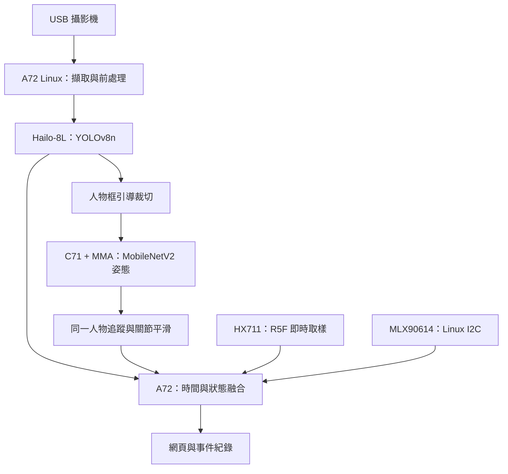

# BeagleBone AI-64 × Hailo-8L

**繁體中文** | [English](README.en.md)

## 異質多核心嵌入式 AI 系統：雙 NPU、雙模型協同推論與感測融合

[系統架構](docs/architecture.md) · [模型轉換](docs/model-pipelines.md) · [操作與重建](docs/operations.md) · [實測與限制](docs/validation.md) · [開發紀錄](docs/development-notes.md)

以 BeagleBone AI-64 為核心，將 **A72 Linux、Hailo-8L、TI C71／MMA 與 R5F** 組成具有明確運算分工的嵌入式 AI 系統。作品以桌面互動感測台呈現：攝影機辨識人物與物品、姿態模型追蹤人體關節、荷重感測判定物品放置與移除，並同步顯示紅外線表面溫度。

**專案的核心工作是打通板級支援、模型部署、遠端核心韌體與 Linux 應用之間的整合路徑。** 從兩組預訓練權重的匯出、校正、量化與編譯，到 C71 推論服務、R5F 感測韌體、裝置樹保留記憶體、連結配置、快取管理與跨核心通訊，再將這些能力接成開機自動運行的系統服務。

兩個模型具有前後相依的資料流：Hailo 的人物偵測框決定 TI 姿態模型的裁切區域，姿態輸出的手腕線索再與荷重變化、物品類別及時間資訊結合。系統同時處理非同步推論、座標還原、資料過期、遮擋與感測先於影像辨識完成等實際整合問題。

**作者：范家豪（Fan Chia-Hao）**

> 本專案的「雙 NPU」指 **Hailo-8L 與 TI MMA 兩個 AI 加速單元**。TI 姿態服務由 C71 DSP 執行 TIDL 並使用 MMA；C71 本身是 DSP，R5F 負責感測，沒有被計入第二顆 NPU。

### 已完成的系統行為

- 開機後，感測與影像兩個系統服務自動啟動，不依賴 SSH 終端機。
- 網頁同時顯示人物、瓶子、杯子與手機的偵測框、人體骨架、秤台有無物品、紅外線視野表面溫度與最近事件。
- 物件偵測模型使用**自行匯出、校正、量化與編譯的 HEF**；姿態模型使用**自行轉換與量化的 TIDL 模型**。
- 人物框、姿態裁切及關節投影有明確座標轉換；顯示骨架使用它所屬的同一張影像。
- 透過人物追蹤、動態平滑、可信度遲滯與短暫保留改善骨架閃動；保留的舊關節不作為新的手腕接近證據。
- 以荷重感測決定物品有無，影像輔助命名；遮擋時仍可記錄類別未確認的放置／移除事件。

### 運算單元與硬體分工

| 單元／硬體 | 負責工作 | 與系統的連接方式 |
|---|---|---|
| A72 雙核心／Linux | 攝影機擷取、影像前處理、模型協調、座標轉換、事件融合與網頁 | OpenCV、多行程／多執行緒、系統服務 |
| Hailo-8L | 執行 YOLOv8n 物件偵測網路，產生人物與物品候選框 | PCIe、HailoRT 原生 C++ 工作行程 |
| C71 DSP／MMA | C71 執行姿態服務、TIDL 執行環境與輸出解碼；MMA 加速模型運算 | 遠端處理器管理（remoteproc）、跨核心訊息（RPMsg） |
| MAIN R5F／HX711 | 產生讀取時脈、擷取 24 位元荷重原始值，回報序號與計時資訊 | R5F 韌體直接操作 GPIO，再由 RPMsg 回傳 |
| MLX90614 | 取得紅外線視野內的表面溫度 | Linux I2C 感測程式 |
| USB 攝影機 C270 | 提供偵測與姿態模型共用的影像來源 | Linux 攝影機介面及穩定裝置識別路徑 |

Linux 排程器管理 A72 上的應用工作；R5F 與 C71 執行各自載入的韌體。應用透過通訊協定協調不同核心，資料融合由 A72 完成。目前部署使用 MAIN R5F 與 C71；C66 不參與此應用，C71 啟動檢查也要求兩顆 C66 保持離線，以避免本配置的共享資源衝突。

### 協同推論資料流



### 板級支援與 C71 推論韌體

**讓模型在 C71／MMA 執行，需要同時完成 Linux 與遠端韌體兩側的記憶體配置。** 本專案整合 TI 平台開發套件（PDK）、SYS/BIOS、深度學習執行環境（TIDL）與矩陣加速函式庫（MMALIB），建立可由 Linux 啟動及呼叫的姿態服務。

- **記憶體所有權：** 以裝置樹（Device Tree）保留額外 128 MiB DDR，核對它已排除於 Linux 一般記憶體，並確認 C71 的 `memory-region` 實際引用該區域；片上共享記憶體（MSMC SRAM）另保留給推論使用。
- **韌體配置：** 協調連結器區段、16 KiB 向量表保留槽、模型資產與 96 MiB TIDL 堆積區（heap），並使資源表、快取與記憶體管理單元（MMU）設定相互一致。
- **推論執行環境：** 依 TIDL 的記憶體需求分配不同區域，串接初始化、模型執行與輸出擷取；處理 SDK 所需的 DMA、事件路由與快取設定。
- **張量布局：** 核對姿態模型介面的尺寸、型別、填補與資料間距（pitch），依該模型布局在應用的緊密排列影像與 TIDL 緩衝區之間搬移資料，再從輸出熱圖解出關節。
- **啟動檢查：** 按硬體名稱 `64800000.dsp` 尋找 C71，核對韌體雜湊、模型版本、通訊協定及目前核心狀態，避免依賴會隨開機變動的 `remoteprocN` 編號。

實作入口：[C71 推論服務](firmware/c71/pdk-overrides/ti/drv/ipc/examples/common/src/bb_pose_service.c)、[連結配置](firmware/c71/pdk-overrides/ti/drv/ipc/examples/common/j721e/linker_c7x_c7x_1_sysbios.lds)、[Linux 啟動與記憶體核對](runtime/c71_pose_client.py)。配置關係與位址見[系統架構](docs/architecture.md#記憶體與遠端核心--memory-and-remote-processors)。

### 跨核心影像傳輸與結果回傳

Linux 與 C71 之間使用自訂 `C71_TIDL_POSE_V2` 協定。一張姿態輸入為 192 × 256 RGB、通道優先排列（CHW）、8 位元無號整數，共 147,456 位元組；客戶端將影像切成每塊最多 240 位元組的影像資料，再加上識別標頭以 RPMsg 傳送。

1. **建立影像交易：** 傳送影格編號、總長度與整張影像 CRC32。
2. **逐塊傳入：** 每塊附帶影格編號與位移，接收端檢查位置；客戶端核對確認封包的下一個位移。
3. **完整性檢查後推論：** 接收端確認資料收齊及 CRC32 相符，才執行該影格的模型請求。
4. **回傳對應結果：** 即時路徑取得 17 個關節的位置與分數；診斷路徑可讀回完整熱圖。客戶端再次核對影格編號與結果格式。

這讓外部攝影機影像可以持續送入 C71，並能區分傳輸錯誤、影格混用與模型輸出問題。傳輸遇到逾時會回報錯誤，避免盲目重送已可能執行的請求。

實作入口：[C71 傳輸處理](firmware/c71/pdk-overrides/ti/drv/ipc/examples/common/src/bb_pose_transport_v2.inc)、[Linux 客戶端](runtime/c71_pose_client.py)。

### 非同步影像處理與座標一致性

兩個模型使用不同輸入尺寸，且推論與攝影機擷取各有執行節奏。應用將**工作排程、影格身分與座標轉換一起管理**：

- 攝影機影像先等比例縮放並補邊（letterbox）為 Hailo 的 640 × 640 RGB 輸入，保留縮放與邊界資訊。
- 人物框經寬高比調整與仿射變換（affine transform）產生 192 × 256 姿態裁切；關節結果經反向變換還原到原始影像。
- Hailo 使用原生 C++ 子行程，Python 透過影像輸入與 JSON 結果介面協調；姿態則由專用工作執行緒呼叫 C71。
- 姿態工作佇列只保留**最新一筆待處理工作**，並丟棄過期工作，避免推論較慢時持續累積舊影像。
- 已送出的工作保留自己的影像、人物框與轉換參數；完成後將骨架畫在對應影像上，避免把上一張的關節套到下一張。
- 使用單調時間（monotonic time）、感測程序身分與關注區域（ROI）版本判斷資料有效性；服務重啟或區域變更後，舊資料不直接延續成新的事件證據。

實作入口：[影像與姿態排程](runtime/interaction_pose_app.py)、[Hailo C++ 工作程式](native/hailo_worker.cpp)、[時序融合](runtime/interaction_fusion.py)。

### 即時感測、姿態穩定與互動事件

**HX711 的讀取時序由 R5F 負責，Linux 負責資料解讀與事件管理。** R5F 韌體在時脈高電位的臨界區暫時關閉中斷，避免高電位被中斷服務拉長；同時檢查脈衝持續時間，並以有界等待處理資料未就緒。回覆包含原始值、序號與遠端計時資訊，Linux 端再檢查新鮮度與狀態，將原始計數轉成物品有無。

事件判定結合三種不同語意的資訊：

| 資訊 | 系統中的用途 | 對應處理 |
|---|---|---|
| 荷重變化 | 判斷秤台從空到有、從有到空 | 中位數、進出不同門檻的遲滯與連續確認 |
| 物件偵測 | 為已發生的放置／移除事件補上物品類別 | 秤台 ROI、單一候選、跨影格類別穩定與延遲確認 |
| 人體關節 | 補充事件附近是否出現手腕接近線索 | 人物框交並比（IoU）追蹤、一歐元濾波器（One Euro Filter）、關節可信度狀態與事件時間窗 |

荷重先改變、影像稍後才辨識到物品時，狀態機保留短暫分類等待期；證據不足就保留「類別未確認」事件。姿態顯示允許短暫保留關節來減少閃動，但**保留的舊關節不能產生新的手腕接近證據**，使顯示平滑與事件判斷具有不同的有效性條件。

實作入口：[R5F HX711 韌體](firmware/r5f/pdk-overrides/ti/drv/ipc/examples/common/src/bb_hx711_v1.h)、[感測服務](runtime/interaction_sensors.py)、[姿態穩定](runtime/interaction_pose_stable.py)、[事件融合狀態機](runtime/interaction_fusion.py)、[互動事件](runtime/interaction_actions.py)。

### 兩條模型路徑

兩個模型分別使用各自的工具鏈建立部署產物。專案程式負責資料準備、階段串接、設定與產物核對，模型最佳化與裝置編譯使用 Hailo／TI 提供的工具。

| | Hailo-8L 物件偵測 | TI C71／MMA 人體姿態 |
|---|---|---|
| 起點 | YOLOv8n 預訓練 `yolov8n.pt` | MMPose MobileNetV2 COCO `.pth` |
| 匯出 | FP32 ONNX，opset 11 | FP32 ONNX，opset 11 |
| 輸入 | 640 × 640 RGB | 192 × 256 RGB 人物裁切 |
| 校正／驗證 | 1,024／128 張實拍影像 | 64／32 張人物裁切，沿用分離的校正／驗證來源 |
| 轉換工具 | Hailo 資料流編譯器 3.33.1 | TIDL 08.00.00.10 |
| 最佳化 | INT8 校正、4 輪量化感知微調 | INT8 參數／特徵量化、10 次偏差校正迭代 |
| 部署產物 | `yolov8n_custom_hailo8l.hef` | TIDL 網路／介面 `.bin`，再與服務連結為 `.xe71` |
| 執行介面 | HailoRT 4.23.0 C++ | TIDL／MMALIB + Linux RPMsg 客戶端 |

#### Hailo-8L：物件偵測轉換流程

| 階段 | 檔案 | 使用介面／工具 | 工作 |
|---|---|---|---|
| 原始權重 | `yolov8n.pt` | Ultralytics `YOLO`、PyTorch | 載入預訓練模型 |
| 通用圖匯出 | `yolov8n.onnx` | `YOLO.export`、ONNX、ONNX Runtime | 匯出 FP32、opset 11、靜態輸入模型，並與 PyTorch 比對 |
| 解析 | `yolov8n_hailo8l.parsed.har` | `hailo_sdk_client.ClientRunner.translate_onnx_model`、`save_har` | 擷取六個偵測分支，轉成 Hailo 網路表示 |
| 浮點設定 | `yolov8n_hailo8l.fp.har` | `load_model_script`、`optimize_full_precision` | 載入正規化、分數分支與非極大值抑制（NMS）設定 |
| 量化與微調 | `yolov8n_hailo8l.quantized.har` | `ClientRunner.optimize` | 校正量化範圍、量化感知微調與雜訊分析 |
| 硬體編譯 | `yolov8n_custom_hailo8l.hef` | `ClientRunner.compile` | Hailo-8L 資源配置，編譯為三個執行脈絡（contexts） |
| 板端推論 | HEF | HailoRT C++ `Hef`、`VDevice`、`InferVStreams` | 載入、輸入串流、推論及偵測後處理 |

**Hailo 路徑：** 匯出 ONNX 後指定 YOLO 的六個偵測輸出頭，建立 Hailo 封存表示（HAR），以模型腳本配置正規化、分數轉換及非極大值抑制（NMS），完成校正與量化感知微調後編譯為 HEF。板端使用 UINT8 影像介面，前處理與模型內正規化保持一致。

#### TI C71／MMA：人體姿態轉換流程

| 階段 | 產物 | 工具 |
|---|---|---|
| 原始模型 | `mobilenetv2_coco_256x192-d1e58e7b_20200727.pth` | MMPose 0.29.0、MMCV、PyTorch |
| 匯出 | `mobilenetv2_pose_256x192.fp32.onnx` | PyTorch ONNX 匯出、ONNX Runtime 比對 |
| 浮點驗證 | TI 浮點網路與輸出 | `tidl_model_import.out`、`PC_dsp_test_dl_algo.out` |
| 校正 | 64 張校正人物裁切、32 張驗證人物裁切 | YOLO 人物框、MMPose 相容仿射裁切 |
| INT8 匯入 | TIDL 網路 `.bin`、輸入／輸出描述 `.bin` | `tidl_model_import.out`、校正與圖編譯 |
| 裝置規劃 | 網路內的資料流配置 | `ti_cnnperfsim.out` |
| 韌體連結 | `c71-pose-v2.xe71` | TI C7000 編譯器、PDK IPC、SYS/BIOS、TIDL、MMALIB |
| 執行 | 17 個關節 | C71 服務、MMA、RPMsg 客戶端 |

**TI 路徑：** 先核對 ONNX 與 TI 浮點主機模擬，再以人物裁切資料完成 INT8 校正與目標圖編譯。部署時將網路與介面描述轉成韌體可使用的模型資產，使用 C7x 工具鏈將 TIDL、MMALIB 與姿態服務連結成韌體，並依輸出描述解碼熱圖。

這次使用的是預訓練類別；量化微調用於降低數值轉換誤差，沒有另行訓練新的物品類別。Hailo 的偵測後處理以 HEF 描述並由所選的 HailoRT CPU 後處理執行。完整流程見[模型轉換文件](docs/model-pipelines.md)。

### 從原型到常駐服務的整合處理

| 整合問題 | 本專案採用的處理 |
|---|---|
| 遠端核心與周邊的 Linux 編號可能變動 | 依硬體名稱、裝置樹控制器與穩定裝置路徑尋找核心、I2C 與攝影機 |
| C71 模型需要額外記憶體與不同張量布局 | 對齊裝置樹、連結配置、資源表、快取與 TIDL 介面描述，啟動前查核實際配置 |
| 內嵌測試影像不足以代表即時應用 | 增加外部影像分塊上傳與完整性檢查，保留原圖／翻轉／恢復原圖的驗證路徑 |
| 非同步姿態可能造成影格錯配及顯示延遲 | 最新待處理工作、工作過期檢查、同影格繪圖及反向座標投影 |
| 人物切換、關節閃動與遮擋 | 人物延續追蹤、動態平滑、可信度遲滯與有限時間保留 |
| 感測事件先於類別辨識，或舊關節造成誤解 | 分類延遲確認、未確認類別保留、手腕新鮮度與事件時間窗檢查 |
| 手動啟動流程難以維護，遠端核心重啟有狀態限制 | 拆成感測與影像服務，加入裝置就緒、開機歸零、受控重新連接及健康檢查 |

感測與影像分為兩個系統服務（systemd），各自保留執行紀錄；感測服務支援不停止 R5F 的重新歸零，影像服務使用受限重試，C71 客戶端結束時保持韌體運行以供後續重新連接。健康檢查同時觀察服務、遠端核心、感測有效性與影格是否持續更新。

整合過程與原因見[開發紀錄](docs/development-notes.md)；測試方法與原始證據集中於[驗證文件](docs/validation.md)。

### 技術實作與程式入口

| 實作範圍 | 本專案完成的工作 | 來源 |
|---|---|---|
| 異質多核心分工 | A72/Linux、Hailo-8L、C71/MMA、R5F 各自負責應用、偵測、姿態與感測 | [架構與資料流](docs/architecture.md) |
| Hailo 完整模型轉換 | PyTorch → ONNX → HAR → 量化感知微調 → HEF；校驗各階段產物 | [Hailo 轉換程式](model-pipelines/hailo/) |
| TI 完整模型轉換 | MMPose 權重 → ONNX → TI 浮點模擬 → INT8 校正 → 裝置圖編譯 | [TI 轉換程式](model-pipelines/pose/) |
| C71 自訂推論服務 | 連結 TIDL／MMALIB、模型資產、記憶體分配、快取與張量間距處理 | [C71 服務](firmware/c71/pdk-overrides/ti/drv/ipc/examples/common/src/bb_pose_service.c) |
| 板級與記憶體整合 | 裝置樹保留 DDR／MSMC，設定連結區段、向量表與遠端核心資源表 | [記憶體配置](docs/architecture.md#記憶體與遠端核心--memory-and-remote-processors) |
| 跨核心影像傳輸 | RPMsg 分塊傳圖、影像編號、位移檢查、CRC32 與關節回傳 | [韌體傳輸](firmware/c71/pdk-overrides/ti/drv/ipc/examples/common/src/bb_pose_transport_v2.inc)／[Linux 客戶端](runtime/c71_pose_client.py) |
| R5F 即時感測 | HX711 24 位元讀取、時脈脈衝保護、序號與計時檢查 | [HX711 韌體](firmware/r5f/pdk-overrides/ti/drv/ipc/examples/common/src/bb_hx711_v1.h) |
| 多行程與多執行緒 | 獨立感測服務、Hailo C++ 行程、姿態工作執行緒、最新影格佇列與網頁服務 | [影像排程](runtime/interaction_pose_app.py)／[C++ 工作程式](native/hailo_worker.cpp) |
| 姿態穩定與事件融合 | 人物延續追蹤、動態濾波、關節狀態、手腕時間窗、物品分類延遲確認 | [姿態穩定](runtime/interaction_pose_stable.py)／[互動事件](runtime/interaction_actions.py)／[融合狀態機](runtime/interaction_fusion.py) |
| 部署與維運 | 系統服務、裝置就緒檢查、開機歸零、訊號歸零、紀錄輪替與健康檢查 | [服務支援](runtime/service_support.py)／[自動啟動安裝器](bringup/board/install_interaction_boot.py) |

### 在已完成部署的板子操作

清空秤台後開機，開啟 `http://<板子 IP>:8080`。固定攝影機，再用網頁框選秤台上表面。每次操作一個物品。

```bash
sudo python3 -u "$HOME/interaction_demo/service-current/service_support.py" status
```

清空秤台後重新歸零，不停止 R5F：

```bash
sudo systemctl reload bbai64-interaction-sensors.service
```

查看紀錄：

```bash
sudo journalctl -b \
  -u bbai64-interaction-sensors.service \
  -u bbai64-interaction-vision.service \
  -n 80 --no-pager
```

重啟板子使用 `sudo reboot`。既有 R5F 版本曾有停止後重新啟動失敗的情況，因此感測服務沒有設定無限制自動重啟。

### 儲存庫內容與重建範圍

| 目錄 | 內容 |
|---|---|
| [`runtime/`](runtime/) | 從已通過開機驗證的服務版本收錄的 Python 程式 |
| [`native/`](native/) | HailoRT C++ 推論工作程式 |
| [`firmware/`](firmware/) | R5F／C71 專案程式、所需 PDK 覆寫與連結配置 |
| [`model-pipelines/`](model-pipelines/) | 兩條模型轉換程式、設定及環境套件紀錄 |
| [`bringup/`](bringup/) | 自動啟動安裝器與其原始輸入程式 |
| [`deploy/`](deploy/) | 實際驗證過的系統服務單元 |
| [`evidence/`](evidence/) | 原始匯出、編譯、驗證及開機紀錄 |
| [`provenance/`](provenance/) | 收錄檔案 SHA256、來源映射與未收錄檔案原因 |
| [`tests/`](tests/) | 不使用板子硬體的狀態與時序回歸測試 |

本版保存**可查核的實作來源及已驗證部署基準**。主機建置程式保留當時的工作目錄、產物雜湊與階段檢查；尚未改造成任意路徑的一鍵安裝套件。TI SDK、編譯器、Hailo 安裝包、模型二進位、校正照片與個人拍攝內容不附在 Git 儲存庫。重建條件、必要產物與已知缺口見[操作與重建](docs/operations.md)。

### 使用邊界

- 秤台判斷「有／無物品」，沒有宣稱公克精度。
- 紅外線數值是感測器視野的表面溫度，不是人體核心溫度，也沒有由影像自動將溫度配準到特定物品。
- 手腕接近表示影像線索，不能證明接觸、拿取因果或使用者身分。
- 目前追蹤一位人物並操作一個秤台物品；遮擋、出畫與低可信度可能使關節不可見。
- 網頁供受信任的本機網路展示，沒有帳號驗證或對外網路部署設定。

[第三方來源與授權註記](THIRD_PARTY_NOTICES.md)
