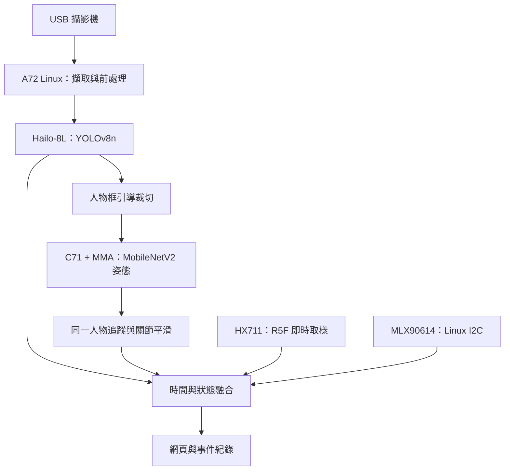

# BeagleBone AI-64 × Hailo-8L

## 異構多核心嵌入式 AI 系統：雙 NPU、雙模型協同推論與感測融合

[English](README.en.md) · [系統架構](docs/architecture.md) · [模型轉換](docs/model-pipelines.md) · [操作與重建](docs/operations.md) · [實測與限制](docs/validation.md) · [開發紀錄](docs/development-notes.md)

這個專案將 **Hailo-8L 物件偵測、TI C71／MMA 人體姿態、R5F 即時荷重感測與 Linux 紅外線測溫**整合為可開機自動運行的桌面互動感測台。

Hailo 找到人物和物品，人物框引導 TI 姿態模型的裁切範圍；R5F 確認秤台是否承受物品，再由 Linux 結合物品類別、手腕接近線索與表面溫度，產生「放上／移走」事件。整個流程包含兩條由原始權重開始的模型轉換、遠端核心韌體、記憶體配置、跨核心通訊及常駐服務。

**作者：范家豪（Fan Chia-Hao）**

> 本專案的「雙 NPU」指 **Hailo-8L 與 TI MMA 兩個 AI 加速單元**。TI 姿態服務由 C71 DSP 執行 TIDL 並使用 MMA；C71 本身是 DSP，R5F 負責感測，沒有被計入第二顆 NPU。

### 已完成的系統行為

- 開機後，感測與影像兩個系統服務自動啟動，不依賴 SSH 終端機。
- 網頁同時顯示物件框、人體骨架、秤台有無物品、紅外線視野表面溫度與最近事件。
- 物件偵測模型使用**自行匯出、校正、量化與編譯的 HEF**；姿態模型使用**自行轉換與量化的 TIDL 模型**。
- 人物框、姿態裁切及關節投影有明確座標轉換；顯示骨架使用它所屬的同一張影像。
- 透過人物追蹤、動態平滑、可信度遲滯與短暫保留改善骨架閃動；保留的舊關節不作為新的手腕接近證據。
- 以荷重感測決定物品有無，影像輔助命名；遮擋時仍可記錄類別未確認的放置／移除事件。

### 技術實作與程式入口

| 實作範圍 | 本專案完成的工作 | 來源 |
|---|---|---|
| 異構多核心分工 | A72/Linux、Hailo-8L、C71/MMA、R5F 各自負責應用、偵測、姿態與感測 | [架構與資料流](docs/architecture.md) |
| Hailo 完整模型轉換 | PyTorch → ONNX → HAR → 量化感知微調 → HEF；校驗各階段產物 | [Hailo 轉換程式](model-pipelines/hailo/) |
| TI 完整模型轉換 | MMPose 權重 → ONNX → TI 浮點模擬 → INT8 校正 → 裝置圖編譯 | [TI 轉換程式](model-pipelines/pose/) |
| C71 自訂推論服務 | 連結 TIDL／MMALIB、模型資產、記憶體分配、快取與張量間距處理 | [C71 服務](firmware/c71/pdk-overrides/ti/drv/ipc/examples/common/src/bb_pose_service.c) |
| 板級與記憶體整合 | 裝置樹保留 DDR／MSMC，設定連結區段、向量表與遠端核心資源表 | [記憶體配置](docs/architecture.md#記憶體與遠端核心--memory-and-remote-processors) |
| 跨核心影像傳輸 | RPMsg 分塊傳圖、影像編號、位移檢查、CRC32 與關節回傳 | [韌體傳輸](firmware/c71/pdk-overrides/ti/drv/ipc/examples/common/src/bb_pose_transport_v2.inc)／[Linux 客戶端](runtime/c71_pose_client.py) |
| R5F 即時感測 | HX711 24 位元讀取、時脈脈衝保護、序號與計時檢查 | [HX711 韌體](firmware/r5f/pdk-overrides/ti/drv/ipc/examples/common/src/bb_hx711_v1.h) |
| 多行程與多執行緒 | 獨立感測服務、Hailo C++ 行程、姿態工作執行緒、最新影格佇列與網頁服務 | [影像排程](runtime/interaction_pose_app.py)／[C++ 工作程式](native/hailo_worker.cpp) |
| 姿態穩定與事件融合 | 人物延續追蹤、One Euro 平滑、關節狀態、手腕時間窗、物品分類延遲確認 | [姿態穩定](runtime/interaction_pose_stable.py)／[互動事件](runtime/interaction_actions.py)／[融合狀態機](runtime/interaction_fusion.py) |
| 部署與維運 | 系統服務、裝置就緒檢查、開機歸零、訊號歸零、紀錄輪替與健康檢查 | [服務支援](runtime/service_support.py)／[自動啟動安裝器](bringup/board/install_interaction_boot.py) |

### 協同推論資料流



兩個模型之間具有實際資料依賴：YOLOv8n 的人物框決定姿態輸入；姿態的手腕資訊再參與事件描述。荷重、影像與姿態各自保留有效性與時間資訊。

### 已觀察到的實測結果

| 項目 | 結果 | 測量範圍 |
|---|---|---|
| 整合展示 | 約 **9.7～10.1 張／秒** | 攝影機、兩個模型、繪圖與網頁更新的展示紀錄 |
| Hailo 獨立串流測試 | **139.45 張／秒**；5 秒內 702 張 | `hailortcli run`；不等同整套應用速度 |
| C71 外部傳圖 | 約 **38 毫秒** | 一張 147,456 位元組 RGB／CHW 輸入的傳輸 |
| C71 推論請求往返 | 約 **7.6～7.7 毫秒** | 外部傳圖測試；包含通訊與服務開銷，不是純 MMA 核心時間 |
| C71 與 TI 主機模擬 | 最大絕對差 **5.96 × 10⁻⁸** | 一張參考影像的 52,224 個反量化輸出；17 個熱圖峰值位置相同 |
| 重開機驗證 | 兩個服務啟用、R5F／C71 運行、感測有效、影格更新 | [來源中的開機健康紀錄](evidence/board/boot-validation.json) |

以上為這台設備與這次模型版本的結果。數值一致性測試不是人體關節真值準確度；完整比較與證據來源見[實測文件](docs/validation.md)。

### 兩條模型路徑

| | Hailo-8L 物件偵測 | TI C71／MMA 人體姿態 |
|---|---|---|
| 起點 | YOLOv8n 預訓練 `yolov8n.pt` | MMPose MobileNetV2 COCO `.pth` |
| 匯出 | FP32 ONNX，opset 11 | FP32 ONNX，opset 11 |
| 輸入 | 640 × 640 RGB | 192 × 256 RGB 人物裁切 |
| 校正／驗證 | 1,024／128 張實拍影像 | 64／32 張人物裁切，沿用分離的校正／驗證來源 |
| 轉換工具 | Hailo 資料流編譯器 3.33.1 | TIDL 08.00.00.10 |
| 最佳化 | INT8 校正、4 輪量化感知微調 | INT8 參數／特徵量化與校正 |
| 部署產物 | `yolov8n_custom_hailo8l.hef` | TIDL 網路／介面 `.bin`，再與服務連結為 `.xe71` |
| 執行介面 | HailoRT 4.23.0 C++ | TIDL／MMALIB + Linux RPMsg 客戶端 |

這次使用的是預訓練類別；量化微調用於降低數值轉換誤差，沒有另行訓練新的物品類別。Hailo 的偵測後處理以 HEF 描述並由所選的 HailoRT CPU 後處理執行，不能將整個後處理計入 NPU 運算。

### 在已完成部署的板子操作

清空秤台後開機，開啟 `http://<板子 IP>:8080`。固定攝影機，再用網頁框選秤台上表面。每次操作一個物品。

```bash
sudo python3 -u "$HOME/interaction_demo/service-current/service_support.py" status
```

清空秤台後重新歸零，不停止 R5F：

```bash
sudo systemctl reload bbai64-interaction-sensors.service
```

查看紀錄：

```bash
sudo journalctl -b \
  -u bbai64-interaction-sensors.service \
  -u bbai64-interaction-vision.service \
  -n 80 --no-pager
```

重啟板子使用 `sudo reboot`。既有 R5F 版本曾有停止後重新啟動失敗的情況，因此感測服務沒有設定無限制自動重啟。

### 儲存庫內容與重建範圍

| 目錄 | 內容 |
|---|---|
| [`runtime/`](runtime/) | 從已通過開機驗證的服務版本收錄的 Python 程式 |
| [`native/`](native/) | HailoRT C++ 推論工作程式 |
| [`firmware/`](firmware/) | R5F／C71 專案程式、所需 PDK 覆寫與連結配置 |
| [`model-pipelines/`](model-pipelines/) | 兩條模型轉換程式、設定及環境套件紀錄 |
| [`bringup/`](bringup/) | 自動啟動安裝器與其原始輸入程式 |
| [`deploy/`](deploy/) | 實際驗證過的系統服務單元 |
| [`evidence/`](evidence/) | 原始匯出、編譯、驗證及開機紀錄 |
| [`provenance/`](provenance/) | 收錄檔案 SHA256、來源映射與未收錄檔案原因 |
| [`tests/`](tests/) | 不使用板子硬體的狀態與時序回歸測試 |

本版保存**可查核的實作來源及已驗證部署基準**。主機建置程式保留當時的工作目錄、產物雜湊與階段檢查；尚未改造成任意路徑的一鍵安裝套件。TI SDK、編譯器、Hailo 安裝包、模型二進位、校正照片與個人拍攝內容不附在 Git 儲存庫。重建條件、必要產物與已知缺口見[操作與重建](docs/operations.md)。

### 使用邊界

- 秤台判斷「有／無物品」，沒有宣稱公克精度。
- 紅外線數值是感測器視野的表面溫度，不是人體核心溫度，也沒有由影像自動將溫度配準到特定物品。
- 手腕接近表示影像線索，不能證明接觸、拿取因果或使用者身分。
- 目前追蹤一位人物並操作一個秤台物品；遮擋、出畫與低可信度可能使關節不可見。
- 網頁供受信任的本機網路展示，沒有帳號驗證或對外網路部署設定。

[第三方來源與授權註記](THIRD_PARTY_NOTICES.md) · [展示錄影流程](docs/demo-recording.md)
