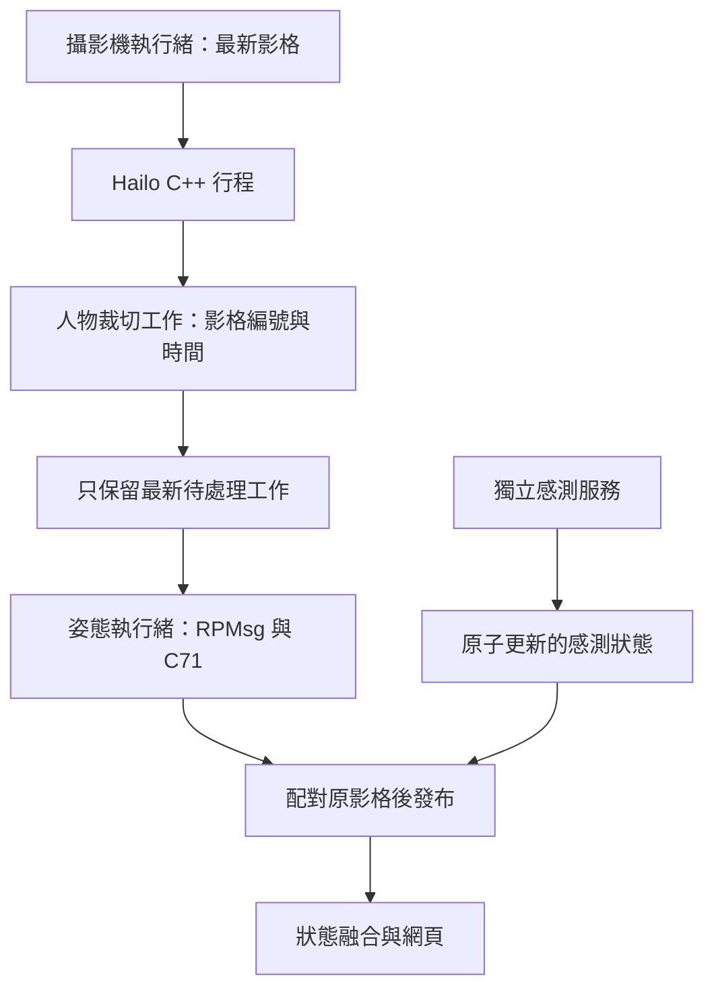

# 系統架構 / System architecture

[首頁 / Home](../README.md)

## 核心分工 / Compute ownership

| 執行單元 / Unit | 工作 / Responsibility | 通訊 / Interface |
|---|---|---|
| A72 Linux | 攝影機、裁切、座標投影、服務、融合、網頁 / Capture, crop, projection, services, fusion, UI | OpenCV、HailoRT、RPMsg、I2C |
| Hailo-8L | YOLOv8n 物件與人物偵測 / Object and person detection | PCIe + HailoRT C++ |
| C71 + MMA | TIDL 人體姿態推論 / TIDL pose inference | Linux remoteproc + RPMsg |
| R5F mcu2_0 | HX711 時脈與資料讀取 / Clocked load-cell acquisition | GPIO + RPMsg |

Linux 依控制器名稱 `5c00000.r5f`、`64800000.dsp` 選核心，不將 `remoteproc1`、`remoteproc5` 當成永久編號。兩個 C66 沒有參與這個部署；C71 啟動檢查要求它們保持離線，以避免本次自訂資源配置互相衝突。

Linux resolves remote processors by controller name, not enumeration index. The C66 cores are unused and required offline by the custom C71 startup checks.

## 同時執行與影格一致性 / Concurrency and frame identity

`interaction_app.py` 提供攝影機與 Hailo 通訊；`interaction_pose_app.py` 加入姿態工作；`interaction_pose_stable.py` 加入追蹤與平滑；`interaction_actions.py` 是最終網頁服務入口。感測獨立為另一個系統服務。

The application layers extend capture/Hailo, pose processing, temporal stability and event annotation. Sensing runs in a separate system service.

待處理姿態工作只保留最新一份，避免推論較慢時無限堆積延遲。進行中的工作仍保留自己的影格、人物框及轉換參數；回傳關節投影回該影格後才發布。使用單調時鐘檢查資料年齡，並以開機識別、感測程序識別與區域修訂編號避免混用不同生命週期的資料。

The pose worker keeps one latest pending job. In-flight jobs retain their own image and geometry; results are published with that frame. Monotonic freshness checks, boot/run identity and ROI revision prevent stale or cross-session associations.

## 座標與張量 / Coordinates and tensors

1. 攝影機 BGR 影像等比例縮放、補邊為 640 × 640，轉 RGB，輸入 Hailo；除以 255 的正規化已放入模型設定。
2. 人物框位於補邊後的座標系；依 MMPose 的人物比例與擴邊規則，仿射裁切成寬 192、高 256。
3. 傳給 C71 的資料為 RGB、CHW、UINT8，共 `3 × 256 × 192 = 147456` 位元組。TI 模型負責其輸入正規化。
4. C71 輸出 17 × 64 × 48 的 INT8 熱圖。服務處理含填補的輸出間距，取峰值及局部修正後回傳關節。
5. Linux 使用裁切反矩陣與影像補邊參數，將關節還原至原始攝影機影像。

The same sequence is: BGR capture → RGB letterbox → Hailo person box → affine person crop → planar UINT8 RPMsg input → TIDL INT8 heatmaps → keypoint decoding → inverse projection to the source frame. The DSP runtime follows the TIDL IO descriptor's padded pitches rather than assuming tightly packed buffers.

## 記憶體與遠端核心 / Memory and remote processors

所有範圍終點不含。 / All range ends are exclusive.

| 區域 / Region | 範圍 / Range | 用途 / Purpose |
|---|---|---|
| C71 原 DDR / Existing DDR | `0xA8100000–0xA9000000` | 程式、資料與資源表 / Program, data, resource table |
| 向量表保留槽 / Vector slot | `0xA8400000–0xA8404000` | 16 KiB 獨立槽；實際向量資料較小 / Reserved slot, not actual table size |
| 新增 DDR 保留 / Additional reservation | `0xAC000000–0xB4000000` | 128 MiB，從 Linux 一般記憶體移除 / Excluded from ordinary Linux RAM |
| TIDL 記憶體池 / Heap | `0xAC000000–0xB2000000` | 96 MiB 靜態區段 / Static heap section |
| 本版模型資產 / Assets | `0xB2000000–0xB29D4680` | 網路、介面及測試資產 / Network, IO and test assets |
| MSMC SRAM | `0x70020000–0x707E8000` | 7968 KiB；避開前段 ATF 區 / Excludes the initial ATF region |

裝置樹保留、Linux 記憶體登記、遠端核心 `memory-region`、連結器位置與韌體的快取／記憶體設定必須相符。**單看 ELF 位址在實體 DDR 內並不足以允許載入；Linux 仍可能使用未保留的區域。**

Device-tree reservations, Linux memory ownership, remoteproc memory regions, linker placement and firmware memory/cache configuration must agree. Physical RAM availability alone is not permission to use it from a remote core.

本倉庫收錄[部署前記憶體探測](../evidence/board/c71-memory-probe.json)、[實際啟動項目](../evidence/board/boot/extlinux.conf)、[最終連結配置](../firmware/c71/pdk-overrides/ti/drv/ipc/examples/common/j721e/linker_c7x_c7x_1_sysbios.lds)及[部署後開機健康紀錄](../evidence/board/boot-validation.json)。探測檔屬於保留之前的規劃證據，不能單獨拿來證明新裝置樹已生效；已部署板上的客戶端仍會檢查當次開機的配置。

The pre-reservation probe is planning evidence, not proof that a later reservation took effect. The deployed client checks the live board configuration. The generated DTB itself is not bundled.

## 通訊契約 / Protocol contracts

| 通道 / Channel | 格式與檢查 / Format and checks |
|---|---|
| R5F HX711 | `HX,HELLO`／`HX,INIT`／讀取請求；原始計數、序號、R5F 時間及脈衝計時 / Samples, sequence, remote time and pulse timing |
| C71 | `C71_TIDL_POSE_V2`；147456 位元組輸入、240 位元組資料分塊、影格識別、位移、確認與 CRC32 / Framed chunked input with integrity checks |
| C71 輸出 / Output | 全熱圖 52224 個 INT8；即時路徑回傳 17 關節與統計的封包 / Full heatmap for verification; compact keypoints for live operation |
| Hailo 工作行程 / Worker | 標準輸入傳固定長度 RGB；標準輸出逐行 JSON / Fixed-size RGB input, line-delimited JSON detections |
| 感測狀態 / Sensor status | JSON 原子更新，含 boot/run 識別、單調時鐘、有效性 / Atomic JSON with lifecycle identity and validity |

## 事件與可信度 / Events and confidence

- HX711 以中位數、遲滯及連續確認穩定有無判斷；本版門檻為 5000／2500 計數，不代表固定重量。
- 原生 Hailo 工作程式先保留四類且分數至少 0.35；融合另要求物品分數至少 0.45。
- 物品框底部中心要在秤台區域內，且恰有一個候選；同類延續至少三次、跨越 250 毫秒後確認。
- 放置事件最多等待兩秒以取得類別，仍無法確認時記錄未確認類別；不偽造物品名稱。
- 人物追蹤使用框交集比與起始／延續門檻，避免每張影像立即切換到另一人。
- One Euro 平滑使用影像長邊正規化座標；關節有 0.30／0.20 遲滯、兩次確認及最長 0.2 秒短暫保留。
- 手腕線索要求當次有效關節、分數至少 0.30、區域接近且跨越至少 80 毫秒的兩次觀察。比對感測事件前 800 毫秒至後 200 毫秒；舊點與不同程序／區域的證據不混用。

Presence comes from the load sensor. Object naming requires a unique temporally stable in-ROI candidate. Wrist annotations require fresh pose evidence in a bounded time window. Tracking and display smoothing do not upgrade missing observations into physical contact claims.
